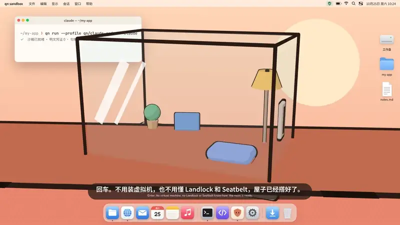
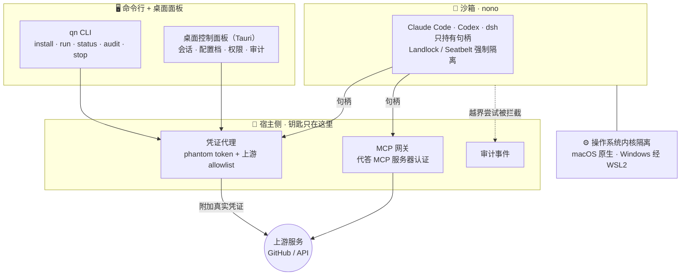

<div align="center">


# qn sandbox

**桌面级 AI 安全沙箱 · Secure Agent Sandbox**

让 Claude Code、Codex、dsh 在内核强制的最小权限里放手干活，钥匙始终在你手里。

<p>
  
  
  
  
</p>



<p>
  <a href="docs/spec/00-product-scope.md">产品范围</a> ·
  <a href="docs/spec/01-architecture.md">架构</a> ·
  <a href="docs/spec/08-security.md">安全</a> ·
  <a href="docs/dev-notes/macos-demo-runbook.md">macOS 演示流程</a> ·
  <a href="docs/media/intro/qn-sandbox-intro.mp4">完整视频（含旁白）</a>
</p>

</div>

---

## 为什么需要它

AI 编码代理（Claude Code、Codex、dsh……）在你的电脑上能读写文件、执行命令、联网。可 SSH 密钥、云账号也躺在同一台机器上：网页里藏一句坏指令，就可能让 Agent 把密钥读走、发出去。

现有的选择要么太重（VM：导镜像、同步文件、启动慢），要么太散（手写 Seatbelt / Landlock 策略），要么和凭证安全冲突（把密钥写进容器配置）。

**qn sandbox 给 Agent 一间关得住、但待着很舒服的屋子：**

| | |
| --- | --- |
| 🔑 **钥匙在屋外** | 真实凭证只在宿主侧。Agent 只拿到短时、受限的句柄（phantom token），由宿主侧代理替它去用 |
| 🧱 **默认关着门** | 文件和网络默认拒绝，按配置档（profile）放行；越界动作当场拦截 |
| 🧾 **看得见** | 每次拦截、每次代用都留下用户可读的审计记录 |
| ✂️ **随时收回** | 一键撤销会话，句柄立即失效 |
| 🔌 **MCP 也安全** | MCP 配置里只写句柄，密钥由宿主侧网关代答 |
| 🙌 **零技术配置** | 不用懂 Landlock、Seatbelt 或 WSL2，一条命令或点一下就能跑 |

## 用起来是什么样

现在已经可以从源码跑通 **macOS 最小演示链路**：安装 → 配置档 → 受限运行 → 审计 → 停止。完整步骤和安全验收清单见 [macOS 最小演示流程](docs/dev-notes/macos-demo-runbook.md)。

**安装 `qn` 命令行**（目前还没有发布安装包，先从源码装一次，需要 Rust 工具链）：

```bash
cargo install --locked --path crates/qn-cli   # 装好后命令就是 qn
qn --version
```

**之后直接用 `qn`：**

```bash
# 诊断与安装：校验锁定版本的 nono（archive 完整性 + 版本）
qn doctor --config-only
qn install
qn doctor

# 官方配置档
qn profile list
qn profile show qn/claude-code

# 在项目目录里，用官方配置档受限运行 Claude Code
qn run --profile qn/claude-code -- claude

# 会话状态、审计、停止（SESSION_ID 来自 run 的输出）
qn status "$SESSION_ID"
qn audit show "$SESSION_ID"
qn stop "$SESSION_ID"
```

> 当前链路尚未覆盖 Windows WSL2、Tauri 安装包、daemon HTTP/RPC、带认证的 MCP 传输和真实 provider 凭证代答（见演示流程 §7）。一键撤销与桌面面板仍在开发中。

桌面控制面板将提供 **会话 · 配置档 · 权限 · 审计** 四个视图。官方配置档首批为 [`qn/claude-code`](profiles/claude-code.json) 与 [`qn/codex`](profiles/codex.json)；dsh 在规划中。

## 它怎么工作

一层一层搭起来：最底下是操作系统内核的隔离能力，开源安全内核 [nono](https://github.com/nolabs-ai/nono) 把墙砌牢，凭证代理和 MCP 网关替 Agent 保管钥匙，最上面是你用的命令行和桌面面板。



**安全不变式**（每个实现决策都必须守住）：

- 真实凭证绝不进入沙箱的文件系统、环境变量、进程参数或 Agent 上下文。
- Agent 只拿到短时、受限作用域的占位符或代理句柄。
- MCP 凭证在宿主侧注入，永不下发给 Agent。
- 文件系统与网络权限默认拒绝、按配置档放行。
- 特权动作产生用户可见的审计事件。
- 撤销会话即刻使占位符与代理访问失效。

## 平台

| 平台 | 隔离机制 | 说明 |
| --- | --- | --- |
| macOS 13+（Apple Silicon / Intel） | nono · Seatbelt | 宿主直跑，无 VM |
| Windows 11 / Win10 22H2（含 Home） | qn 供给 WSL2 + nono · Landlock | 发行版安装、内核探测与升级全部自动化 |
| （P2）强隔离模式 | 独立 VM + guest 内 nono | 面向需要独立内核的合规场景，默认不开 |

## 路线图

| 优先级 | 工作包 | 交付 |
| --- | --- | --- |
| **P0** | M0 · M1 · M2 | 安全路径端到端（macOS + Windows）：沙箱适配器、凭证代理、MCP 网关、官方配置档、最小桌面面板、审计与攻击演示 |
| **P1** | M3 | 统一 API / SDK、配置档注册表、沙箱即 MCP 工具 |
| **P2** | M4 | 强隔离 VM 模式、网络策略 UI、资源配额、企业审计报表 |

详见 [docs/spec/00-product-scope.md](./docs/spec/00-product-scope.md) §4。

## 仓库结构

```text
crates/
├── qn-core        领域模型（Sandbox / Profile / Grant / AuditEvent）与 ports
├── qn-nono        引擎适配器：nono 安装与版本锁定、拉起、状态与审计采集
├── qn-broker      凭证代理：phantom token + 上游 allowlist，grant / revoke 生命周期
├── qn-gateway     MCP 网关：宿主侧代答 MCP 认证，Agent 配置只有句柄
├── qn-wsl         Windows 供给链路：WSL2 安装、内核探测与升级、nono 引导
├── qn-daemon      控制面后端：装配适配器、状态与审计查询
├── qn-cli         qn 命令行（run / exec / status / audit / doctor）
├── qn-ui          最小 Tauri 壳：配置档 / 权限 / 状态 / 审计
├── qn-mcp         沙箱即 MCP 工具（M3）
├── qn-config      配置、路径、平台常量与锁定版本
├── qn-infra       process / fs / logging / retry 等通用机制
├── qn-bootstrap   装配根：构造适配器并注入 core
└── qn-vm          P2 强隔离模式占位
profiles/          官方配置档（qn/claude-code、qn/codex）与清单
sdks/              控制面契约（control-plane-v1）与 TypeScript / Python 客户端边界
tests/             端到端与攻击演示剧本（tests/e2e）
scripts/           架构依赖检查、本地验证、nono 升级回归
docs/              产品范围、架构、编码 / 测试 / 安全规范、术语表、演示流程
```

依赖方向与分层规则见 [docs/spec/01-architecture.md](./docs/spec/01-architecture.md)。

## 文档地图

| 文档 | 内容 | 读者 |
| --- | --- | --- |
| [AGENTS.md](./AGENTS.md) | **AI 协作总规范**：AI 在本仓库中如何思考、写代码、验证、汇报 | 所有 AI Agent（必读第一篇） |
| [docs/spec/00-product-scope.md](./docs/spec/00-product-scope.md) | 产品定位、平台与机制、P0/P1/P2 ↔ M0–M4、非目标 | 所有人 |
| [docs/spec/01-architecture.md](./docs/spec/01-architecture.md) | 架构规则：分层、crate 划分、依赖方向、ports | 开发者 / AI |
| [docs/architecture-breakdown.md](./docs/architecture-breakdown.md) | **架构拆分**：C4 三级视图、组件五要素、port 语义表、依赖矩阵 | 开发者 / AI |
| [docs/spec/02-coding-standard-rust.md](./docs/spec/02-coding-standard-rust.md) | Rust 编码规范（整洁代码细则 + 正反例） | 开发者 / AI |
| [docs/spec/03-coding-standard-sdk.md](./docs/spec/03-coding-standard-sdk.md) | TypeScript / Python SDK 编码规范 | 开发者 / AI |
| [docs/spec/04-dependency-reuse.md](./docs/spec/04-dependency-reuse.md) | 依赖政策与复用矩阵（nono 锁版纪律） | 开发者 / AI |
| [docs/spec/05-testing-quality.md](./docs/spec/05-testing-quality.md) | 测试策略、质量门禁、验收定义 | 开发者 / AI |
| [docs/spec/06-git-workflow.md](./docs/spec/06-git-workflow.md) | 分支、提交、PR 规范、版本化 | 开发者 / AI |
| [docs/spec/07-documentation.md](./docs/spec/07-documentation.md) | 文档规范与重大决策记录流程（issue + spec） | 开发者 / AI |
| [docs/spec/08-security.md](./docs/spec/08-security.md) | 安全边界、威胁模型、安全编码要求 | 开发者 / AI |
| [docs/spec/09-team-split.md](./docs/spec/09-team-split.md) | 三人协作分工：主责领域、工作包矩阵、接口共治、评审安排 | 所有人 |
| [docs/spec/glossary.md](./docs/spec/glossary.md) | 术语表 | 所有人 |
| [docs/dev-notes/macos-demo-runbook.md](./docs/dev-notes/macos-demo-runbook.md) | **macOS 最小演示流程**：安装 → 配置档 → 受限运行 → 审计 → 停止，含安全验收清单 | 所有人 |
| [TODO.md](./TODO.md) | 工程待办：M0 前置 spike、CI 与覆盖率门禁 | 所有人 |

## 参与贡献

本仓库为七牛 1024 Hackathon 项目，正在积极开发中，从不可移动的 `v0` 基线起步。分支、Review 与安全规则见 [CONTRIBUTING.md](CONTRIBUTING.md)；AI 协作规则见 [AGENTS.md](AGENTS.md)。

内部赛题材料与本地凭证不属于本仓库，任何真实凭证都不应出现在提交、日志或截图中。

<div align="center">
<br/>
<sub>关得住，也待得舒服。<i>Safe by default. Comfortable by design.</i> · <a href="docs/brand/">品牌素材</a></sub>
</div>
