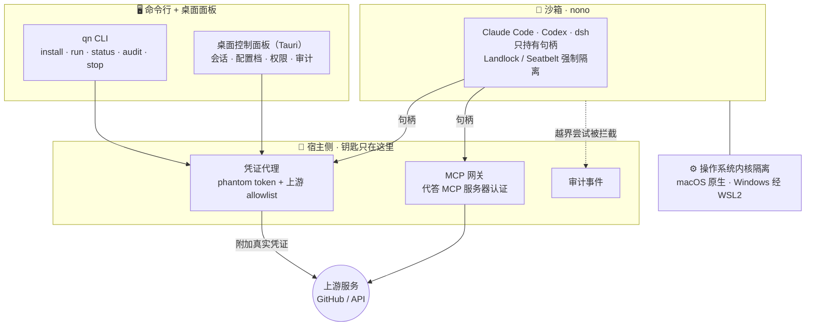

<a id="qn-sandbox"></a>

<div align="center">

<picture>
  <source media="(prefers-color-scheme: dark)" srcset="docs/brand/logo-lockup-dark.svg">
  
</picture>

### 让 Agent 放手干活，让权限留在你手里。

桌面级 AI 安全沙箱 · Built on nono

<p>
  
  
  
</p>

[快速开始](#快速开始) · [进展](#当前进展) · [安全](#设计与安全) · [文档](#开发文档)

</div>

## 两分钟，认识 qn sandbox

https://github.com/user-attachments/assets/9dc8b557-b54c-486e-bfd8-e505e350858a

<p align="center">
  <sub>02:23 · 中文旁白 · 中英字幕 · 1080p</sub><br>
  <a href="docs/media/intro/qn-sandbox-intro.srt">字幕文件</a> ·
  <a href="docs/media/intro/qn-sandbox-intro.mp4">轻量版视频</a> ·
  <a href="docs/dev-notes/macos-demo-runbook.md">实际演示流程</a>
</p>

> [!NOTE]
> **当前处于 P0 开发阶段。** 视频展示产品设计，包含尚在开发的桌面面板和一键撤销。当前可演示范围为 macOS CLI 链路；完整凭证代答、MCP 认证传输及跨平台验收进展见下方说明。

## 为什么做它

Agent 需要读文件、执行命令和联网；你的 SSH 密钥、云账号和工作资料也在同一台电脑上。qn sandbox 的目标，是让 Agent 在明确的权限边界内工作，并把真实凭证留在宿主侧。

| 有边界地运行 | 在宿主侧用凭证 | 把证据交给用户 |
| :--- | :--- | :--- |
| 复用 nono 的内核级隔离，文件与网络默认拒绝，按 profile 放行。 | Agent 只持有受限句柄，凭证代理与 MCP 网关负责宿主侧代答。 | 呈现会话状态和审计来源，保留未验证、部分记录与清理不确定性。 |

这是产品的设计原则；实际完成范围与验收证据分别列在[当前进展](#当前进展)和[安全演示清单](docs/dev-notes/macos-demo-runbook.md#6-安全验收清单)。

## 快速开始

**先准备：** macOS 13+、Rust 工具链，以及已经检出的本仓库。当前从源码安装，还没有正式桌面安装包。

**1 · 安装命令行**

在仓库根目录执行：

```bash
cargo install --locked --path crates/qn-cli
qn --version
qn doctor --config-only
```

**2 · 准备引擎与配置档**

先按 [macOS 演示流程](docs/dev-notes/macos-demo-runbook.md#前置条件)准备对应架构的锁定 nono archive、Agent CLI 和专用测试项目，再执行：

```bash
qn install
qn doctor
qn profile list
qn profile show qn/claude-code
```

**3 · 在测试项目中运行**

切换到准备好的测试项目目录：

```bash
qn run --profile qn/claude-code -- claude
```

首批官方配置档为 [`qn/claude-code`](profiles/claude-code.json) 与 [`qn/codex`](profiles/codex.json)，dsh 在规划中。

<details>
<summary><strong>查看会话状态、审计记录与停止命令</strong></summary>

将运行输出中的会话 ID 赋给 `SESSION_ID`，再执行：

```bash
qn status "$SESSION_ID"
qn audit show "$SESSION_ID"
qn audit native "$SESSION_ID"
qn stop "$SESSION_ID"
```

配置诊断成功只代表配置有效；引擎校验成功也不等于完整安全验收。审计的 source / integrity 与 `cleanup: unconfirmed` 必须按实际输出理解。完整步骤见 [macOS 演示流程](docs/dev-notes/macos-demo-runbook.md)。

</details>

## 当前进展

| 范围 | 当前状态 | 入口 |
| :--- | :--- | :--- |
| macOS CLI | 安装、profile、前台运行、状态、审计和停止链路可演示；真实 Agent 安全验收仍需按清单执行 | [演示流程](docs/dev-notes/macos-demo-runbook.md) |
| Windows / WSL2 | 供给适配器持续开发，尚未完成同等端到端验收 | [qn-wsl](crates/qn-wsl/README.md) |
| 桌面面板、完整凭证代答与 MCP 认证传输 | 仍在开发与联调，视频中的设计不代表已全部交付 | [交付跟踪 #82](https://github.com/gac0812/qn-sandbox/issues/82) |

<details>
<summary><strong>路线图：从安全路径到 API 与高级隔离</strong></summary>

| 优先级 | 工作包 | 目标 |
| :--- | :--- | :--- |
| P0 | M0 · M1 · M2 | macOS 与 Windows 安全路径、官方配置档、最小控制面、审计与攻击演示 |
| P1 | M3 | 统一 API / SDK、profile 生态、沙箱即 MCP 工具 |
| P2 | M4 | 可选强隔离 VM、网络策略 UI、资源配额与企业审计 |

详见[产品范围](docs/spec/00-product-scope.md)。macOS 使用 nono / Seatbelt，Windows 路线为 WSL2 / nono / Landlock；VM 是后续可选模式。

</details>

## 设计与安全

**Thin product on [nono](https://github.com/nolabs-ai/nono)。** 内核隔离由 nono 承担，qn 负责适配、配置档、控制面和宿主侧凭证流程；不 fork 安全内核，不实现第二套隔离机制。

- **凭证留在宿主。** 真实凭证不进入沙箱文件系统、环境变量、进程参数或 Agent 上下文；MCP 密钥也不下发。
- **权限默认拒绝。** 文件与网络按 profile 放行，Agent 仅接触短时、受限作用域的占位符或句柄。
- **特权动作可审计。** 撤销使句柄与代理访问失效；记录只声称实际观察到的证据，不把不确定性当作成功。

以上是不变式与验收要求，详见[安全规范](docs/spec/08-security.md)。

<details>
<summary><strong>展开目标架构</strong></summary>



分层、依赖方向和当前实现边界见[架构规范](docs/spec/01-architecture.md)与[架构拆分](docs/architecture-breakdown.md)。

</details>

## 开发文档

| 想做什么 | 从这里开始 |
| :--- | :--- |
| 跑一次真实演示 | [macOS 演示与验收清单](docs/dev-notes/macos-demo-runbook.md) |
| 理解产品与安全边界 | [产品范围](docs/spec/00-product-scope.md) · [安全规范](docs/spec/08-security.md) |
| 参与开发 | [贡献指南](CONTRIBUTING.md) · [AI 协作规范](AGENTS.md) · [本地质量门禁](docs/spec/05-testing-quality.md) |
| 了解设计与实现 | [架构规范](docs/spec/01-architecture.md) · [CLI 文档](crates/qn-cli/README.md) · [术语表](docs/spec/glossary.md) |

<details>
<summary><strong>全部工程文档</strong></summary>

| 文档 | 内容 | 读者 |
| --- | --- | --- |
| [AGENTS.md](./AGENTS.md) | **AI 协作总规范**：AI 在本仓库中如何思考、写代码、验证、汇报 | 所有 AI Agent（必读第一篇） |
| [docs/spec/00-product-scope.md](./docs/spec/00-product-scope.md) | 产品定位、平台与机制、P0/P1/P2 ↔ M0–M4、非目标 | 所有人 |
| [docs/spec/01-architecture.md](./docs/spec/01-architecture.md) | 架构规则：分层、crate 划分、依赖方向、ports | 开发者 / AI |
| [docs/architecture-breakdown.md](./docs/architecture-breakdown.md) | **架构拆分**：C4 三级视图、组件五要素、port 语义表、依赖矩阵 | 开发者 / AI |
| [docs/spec/02-coding-standard-rust.md](./docs/spec/02-coding-standard-rust.md) | Rust 编码规范（整洁代码细则 + 正反例） | 开发者 / AI |
| [docs/spec/03-coding-standard-sdk.md](./docs/spec/03-coding-standard-sdk.md) | TypeScript / Python SDK 编码规范 | 开发者 / AI |
| [docs/spec/04-dependency-reuse.md](./docs/spec/04-dependency-reuse.md) | 依赖政策与复用矩阵（nono 锁版纪律） | 开发者 / AI |
| [docs/spec/05-testing-quality.md](./docs/spec/05-testing-quality.md) | 测试策略、质量门禁、验收定义 | 开发者 / AI |
| [docs/spec/06-git-workflow.md](./docs/spec/06-git-workflow.md) | 分支、提交、PR 规范、版本化 | 开发者 / AI |
| [docs/spec/07-documentation.md](./docs/spec/07-documentation.md) | 文档规范与重大决策记录流程（issue + spec） | 开发者 / AI |
| [docs/spec/08-security.md](./docs/spec/08-security.md) | 安全边界、威胁模型、安全编码要求 | 开发者 / AI |
| [docs/spec/09-team-split.md](./docs/spec/09-team-split.md) | 三人协作分工：主责领域、工作包矩阵、接口共治、评审安排 | 所有人 |
| [docs/spec/glossary.md](./docs/spec/glossary.md) | 术语表 | 所有人 |
| [docs/dev-notes/macos-demo-runbook.md](./docs/dev-notes/macos-demo-runbook.md) | **macOS 最小演示流程**：安装 → 配置档 → 受限运行 → 审计 → 停止，含安全验收清单 | 所有人 |
| [TODO.md](./TODO.md) | 工程待办：M0 前置 spike、CI 与覆盖率门禁 | 所有人 |

</details>

---

<p align="center">
  <strong>关得住，也待得舒服。</strong><br>
  <sub>Safe by default. Comfortable by design.</sub><br><br>
  <a href="CONTRIBUTING.md">参与贡献</a> · <a href="https://github.com/gac0812/qn-sandbox/issues">反馈问题</a> · <a href="docs/brand/">品牌素材</a><br>
  <sub>七牛 1024 Hackathon 项目 · 积极开发中</sub>
</p>
