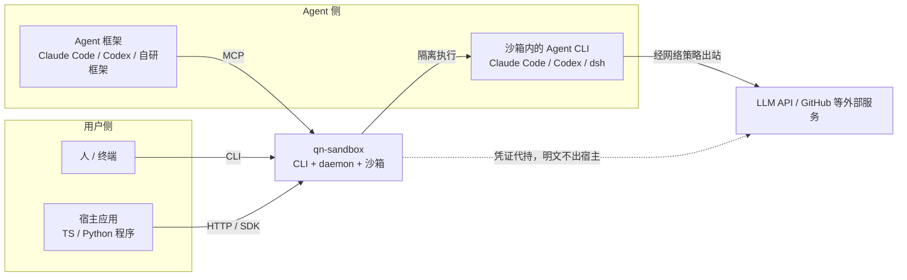
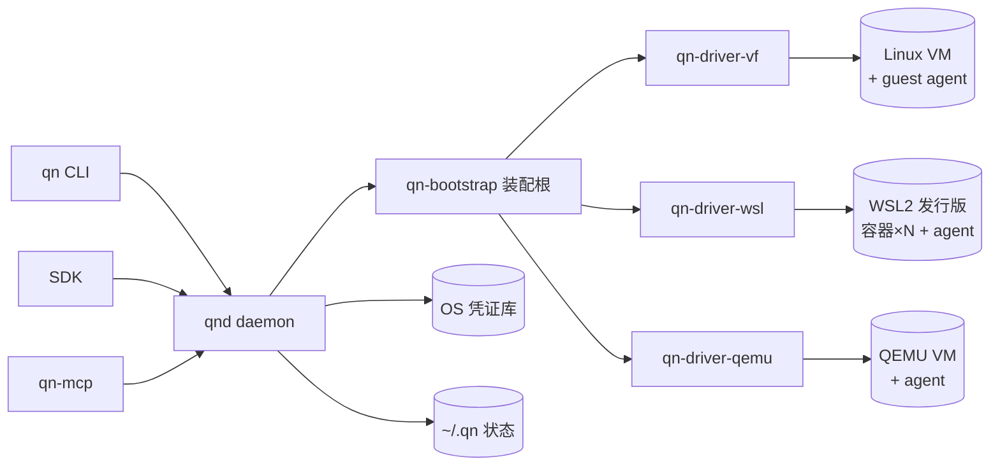

# 架构拆分（System Architecture Breakdown）

状态：Draft · 2026-10-24 · 配套文档：[01-architecture.md](./spec/01-architecture.md)（规则与依赖方向）

> 分工：**01 管规则**（为什么这样定、允许什么、禁止什么），**本文管结构**（系统拆成哪些部分、每部分管什么、边界在哪、如何对接）。
> 冲突以 01 为准，例外是本文 §8 标注的一处修订（装配根独立为 `qn-bootstrap`）。

---

## 1. 系统上下文（C4 L1）

qn-sandbox 是**单机桌面软件**：在一台 Windows / macOS 机器上，为 AI Agent 提供隔离的 Linux 执行环境。



| 参与者 | 与系统的关系 | 关键诉求 |
| --- | --- | --- |
| 人（终端用户） | CLI 创建/管理沙箱 | 零技术配置、5 分钟可用 |
| 宿主应用 | SDK/HTTP 驱动沙箱 | 编程接口稳定、类型安全 |
| Agent 框架 | MCP 接入 | 工具语义清晰、可撤销授权 |
| 沙箱内 Agent CLI | 被隔离执行 + 凭证注入 | 能联网、能用密钥、拿不到明文存储 |
| 外部服务 | 出站目标 | ——（受 NetPolicy 约束） |

---

## 2. 容器视图（C4 L2）——分发包与进程

| 容器 | 形态 | 职责 | 不做什么 | 对外通信 |
| --- | --- | --- | --- | --- |
| `qn`（CLI） | 独立二进制 | 人机入口：参数解析、呈现、`doctor` 环境自检 | 任何业务规则 | 连接 qnd（HTTP/本地回环）；`--direct` 模式下进程内直用 core |
| `qnd`（daemon） | 常驻进程 | 能力中枢：API 服务、驱动装配、沙箱注册表、凭证代理 | 业务规则（在 core）、平台调用（在 driver） | 监听 127.0.0.1（token 认证）；对 guest 走 §6 通道 |
| guest agent | 沙箱内静态二进制 | 执行面：exec（PTY/流式）、文件收发、无凭证本地出口代理 | 任何宿主概念、明文凭证存储 | 沙箱内监听，经通道被宿主访问 |
| drivers ×3 | 链接进 qnd 的库 | 平台适配：把 core port 翻译成 VZ/WSL/QEMU 操作 | 互相调用、业务规则 | 外部工具调用（`wsl.exe`、`qemu-system`）或框架 API |
| OS 凭证库 | 外部存储 | 长期密钥唯一存放地 | —— | 仅经 `keyring`（qn-daemon 独占） |
| 本地状态 | `~/.qn/` 文件 | 注册表、配置、日志、镜像缓存 | 密钥 | 文件锁串行化写入 |



---

## 3. 组件视图（C4 L3）——逐 crate 拆分

> 每个组件五要素：**职责 / 边界（不做什么）/ 内部模块 / 对外接口 / 测试策略**。

### 3.1 `qn-core` — 领域内核
- **职责**：领域模型、业务规则、ports 定义；全部能力只写一遍的地方。
- **边界**：不依赖任何 driver/surface/平台 API；不做平台 IO（除内存对象）。
- **内部模块**：
  | 模块 | 内容 |
  | --- | --- |
  | `domain::sandbox` | `Sandbox`、`SandboxId`、`SandboxSpec`、`SandboxState` **状态机**（`transition()` 全仓库唯一合法迁移表） |
  | `domain::image` | `Image`、`ImageRef`（name:tag@arch）、`ImageManifest` |
  | `domain::exec` | `ExecRequest`、`ExecResult`、`ExecEvent`（流式）、`StopMode` |
  | `domain::secret` | `SecretRef`、`Grant`、`AgentAppId`、`AgentAppCatalog`（模板 → 所需凭证清单） |
  | `domain::policy` | `MountSpec`（白名单挂载）、`PortMapping`、`NetPolicy` |
  | `port::` | `SandboxDriver`、`GuestAgent`、`CredentialBroker`、`ImageStore`（语义见 §5） |
  | `service::` | `SandboxService`（生命周期编排：resolve 镜像 → driver.create → 注册表登记）、`AgentAppService`（模板解析） |
  | `registry` | 沙箱注册表 trait + 内存实现（落盘实现属 daemon，core 只定义接口） |
  | `error` | 统一 `Error` + 各领域错误变体 |
- **测试策略**：状态机穷举迁移表、编排服务用 fake driver/fake store、领域类型 round-trip（serde）。

### 3.2 `qn-config` — 配置与平台常量
- **职责**：`config.toml` + `QN_*` 环境变量合并解析；平台路径（`~/.qn` → `%LOCALAPPDATA%\qn`）；`#[cfg(target_os)]` 白名单位置之一。
- **边界**：无运行时业务逻辑；不读凭证。
- **内部模块**：`parse`（toml/env 分层合并）、`paths`（目录布局唯一权威，§7）、`consts`（默认超时、端口段）。
- **测试**：配置合并优先级矩阵、路径各平台快照。

### 3.3 `qn-infra` — 通用机制
- **职责**：被各层复用的"机制"（不含领域语义）：`process`（外部命令执行：超时/输出截断/命令行记录/退出码）、`fs`（Utf8 路径、原子写、临时目录）、`lockfile`（注册表并发）、`logging`（tracing 初始化与滚动文件）、`retry`（退避封装）。
- **边界**：不知道 Sandbox 是什么。
- **测试**：process 对 stub 可执行文件的契约测试（注入式，见 05 §2）。

### 3.4 `qn-driver-vf` — macOS 后端
- **职责**：把三个 ports 翻译成 Virtualization.framework / arcbox 能力。
- **边界**：`arcbox/` subtree 只读（R4）；无 Windows 代码路径；`unsafe` 仅限 FFI 绑定层。
- **内部模块**：`adapter`（arcbox 类型 ↔ core 类型**单向映射**）、`machine`（create/start/stop/remove/status/list 编排）、`channel`（guest 通道建立与寻址，复用 arcbox vsock）、`snapshot`（M5）。
- **测试**：对 fake arcbox 接口的适配层契约测试；真机 E2E（05 §4 矩阵）。

### 3.5 `qn-driver-wsl` — Windows 后端
- **职责**：WSL2 发行版生命周期 + 其上每沙箱一容器的管理。
- **内部模块**：`distro`（`wsl --import/--unregister` 受管发行版）、`container`（runc/crun CLI 适配，**内部 trait 化**以便未来换运行时）、`bridge`（宿主↔guest 通道寻址与互操作）、`health`（WSL 版本/状态探测）。
- **边界**：输出解析只依赖退出码与结构化标记（容忍本地化输出，02 §6）。
- **测试**：stub `wsl.exe` 契约测试 + Windows 真机 E2E。

### 3.6 `qn-driver-qemu` — 兜底后端
- **内部模块**：`accel`（HVF/WHPX/KVM 能力探测，探测结果缓存）、`machine`（QEMU 进程参数生成与生命周期）、`disk`（镜像挂接）、`net`（user-mode hostfwd 端口映射）。
- **边界**：GPL 的 QEMU 以外部进程方式使用，不链接其代码。
- **里程碑**：M5 前不启动（ADR-0002），crate 骨架先占位。

### 3.7 `qn-agent` — guest 内代理
- **职责**：沙箱内执行面服务；**musl 静态链接**、双架构（aarch64/x86_64）。
- **内部模块**：`rpc`（Connect 服务实现）、`exec`（PTY + 流式 runner，交互式 Agent CLI 的硬前提）、`fs`（tar 流收发）、`proxy`（无凭证本地出口代理：纯转发，M1 起；凭证由宿主网关在出站流量上代答）。
- **边界**：优先复用 arcbox 的 Linux agents，本 crate 只做差量；不依赖宿主端重型依赖。
- **测试**：Linux 容器内集成测试（Ubuntu runner 即可）。

### 3.8 `qn-bootstrap` — 装配根（对 01 的一处修订，见 §8）
- **职责**：按目标平台**选择唯一 driver** 并构造 `Arc<dyn SandboxDriver>`，组装 core service；daemon 与 CLI 直连模式共用，消除两处重复装配。
- **边界**：除装配外无逻辑；`#[cfg(target_os)]` 白名单位置之一。
- **内部模块**：`assembly`（cfg 选择）、`wiring`（service/registry/broker 构造与注入）。

### 3.9 `qn-daemon` — 能力中枢
- **内部模块**：`api`（Connect 服务：sandbox/image/secret/health，薄壳转发 core）、`broker`（`CredentialBroker` 实现 + 认证代答网关：keyring 访问、grant 表、TTL/撤销、**流量代答**、审计日志——**只记引用名不记值**）、`store`（注册表落盘：JSON + fd-lock，**损坏 fail-closed**）、`events`（生命周期事件广播）。
- **边界**：不写业务规则；不碰平台调用。
- **测试**：起真 daemon + fake driver 断言 HTTP 行为与错误码（05 §2）。

### 3.10 `qn-cli` — 人机入口
- **内部模块**：`commands`（clap 树：sandbox/image/exec/cp/doctor）、`output`（human/json 双格式）、`doctor`（环境自检：WSL 版本/虚拟化开启/磁盘空间——"用户友好"的落地件）。
- **边界**：零业务逻辑；`--direct` 模式经 bootstrap 进程内直用 core。

### 3.11 `qn-mcp` — Agent 框架入口
- **内部模块**：`tools`（tool → core 调用映射表：sandbox.* / exec / files / secrets.revoke）、`transport`（stdio + HTTP）。
- **边界**：不旁路实现任何 core 能力。

### 3.12 SDK（`sdks/typescript`、`sdks/python`）
- 契约生成 + 薄人体工学层，规范见 03；不在此重复。

---

## 4. Crate 依赖矩阵（✓ 允许 / ✗ 禁止；CI 由 cargo-deny ban 强制）

| from ↓ \ to → | core | config | infra | bootstrap | driver-* | arcbox | daemon | cli | mcp |
| --- | --- | --- | --- | --- | --- | --- | --- | --- | --- |
| core | — | ✗ | ✗ | ✗ | ✗ | ✗ | ✗ | ✗ | ✗ |
| config | ✗ | — | ✗ | ✗ | ✗ | ✗ | ✗ | ✗ | ✗ |
| infra | ✗ | ✓ | — | ✗ | ✗ | ✗ | ✗ | ✗ | ✗ |
| driver-vf/wsl/qemu | ✓ | ✓ | ✓ | ✗ | ✗ | 仅 vf | ✗ | ✗ | ✗ |
| bootstrap | ✓ | ✓ | ✓ | — | ✓ | ✗ | ✗ | ✗ | ✗ |
| daemon | ✓ | ✓ | ✓ | ✓ | ✗（经 bootstrap） | ✗ | — | ✗ | ✗ |
| cli / mcp | ✓ | ✓ | ✓ | ✓ | ✗（经 bootstrap） | ✗ | ✗ | — | ✗ |
| agent | ✗（独立构建，仅共享契约生成代码） | ✗ | ✗ | ✗ | ✗ | 契约/agents 复用 | ✗ | ✗ | ✗ |

要点：**core 是唯一被所有人依赖、自己不依赖任何人的层**；`bootstrap` 是唯一同时看见 core 与 drivers 的 crate。

---

## 5. 接口契约（port 语义表）

> 签名草案在 01 §4；这里补齐**语义**——实现者与评审据此对齐。

### 5.1 `SandboxDriver`
| 方法 | 语义与不变式 | 幂等性 | 错误变体 |
| --- | --- | --- | --- |
| `create(spec)` | 创建不启动；镜像必须先 resolve 成功；**无默认挂载、无默认凭证** | 同名已存在 → 报错（非重建） | `InvalidSpec`、`ImageMissing`、`ResourceExhausted` |
| `start(id)` | 从 Stopped/Failed 可启动；成功即状态机 `Running`，失败不留半开状态 | 已 Running → Ok | `StateConflict`、`BackendFailure` |
| `stop(id, mode)` | `Graceful`：TERM→超时→KILL（超时常量在 config）；`Kill`：立即 | 已 Stopped → Ok | `StateConflict`、`Timeout` |
| `remove(id)` | 先强制停再删盘；Running 时须显式 stop 过或传 force | 不存在 → Ok（清理语义） | `StateConflict` |
| `status/list` | 只读；状态值必须出自 core 状态机枚举 | 是 | `NotFound` |
| `connect(id)` | 返回 `GuestAgent` 通道；仅 Running 可用；通道断开可重连 | 是 | `NotRunning`、`ChannelUnavailable` |

### 5.2 `GuestAgent`
| 方法 | 语义 | 备注 |
| --- | --- | --- |
| `exec(req)` | 一次性执行，带超时与取消；退出码/信号如实回传 | 超时与取消是不同错误变体（02 §4） |
| `exec_stream(req)` | stdout/stderr 事件流 + **PTY 模式**（交互式 Agent CLI 硬前提） | 事件含 started/output/exit |
| `upload/download` | tar 流；路径白名单校验在宿主侧先做 | 大文件流式，不整载内存 |

### 5.3 `CredentialBroker`
| 方法 | 语义 | 安全不变式（08 §4 / guardrails） |
| --- | --- | --- |
| `grant(id, refs, ttl)` | 授予引用使用权；网关按 grant 在出站流量上代答；审计记 引用名+时间+沙箱 | 明文路径仅：OS 凭证库 → 宿主内存 → 出站认证字段，不出宿主边界 |
| `write_managed_config(id, app, cfg)` | 校验并写沙箱内 MCP/Agent 配置 | 配置含明文 → **拒绝写入**；只允许引用与非敏感代理地址 |
| `revoke(grant)` | 立即断流 | 该沙箱后续出站请求不再获得认证，即刻失效 |

### 5.4 `ImageStore`
| 方法 | 语义 |
| --- | --- |
| `resolve(ref)` | 本地是否存在；返回 manifest（含 arch、digest） |
| `import(src, progress)` | 可取消、有进度事件；来源与 digest 记录入 manifest |
| `remove / list` | 清理与枚举；被引用中的镜像拒绝删除 |

---

## 6. 通道与协议视图（宿主 ↔ guest）

| 驱动 | 通道机制 | 备注 |
| --- | --- | --- |
| vf (macOS) | arcbox 的 vsock 通道（复用上游实现） | 寻址由 driver 的 `channel` 模块封装 |
| wsl (Windows) | 宿主↔发行版 localhost 互操作转发；Win10 兼容性归入 M3 spike 清单 | 解析只依赖结构化标记 |
| qemu (兜底) | user-mode 网络 hostfwd | 端口段常量在 qn-config |

协议统一为 **ConnectRPC（契约同源）**：同一份 proto 同时生成 qnd 对外 API、qn-agent guest 服务、SDK——契约一处改，三端同步（ADR-0003）。代答网关的代理流量复用既有通道与端口转发，不新开协议；沙箱内进程只见本地代理地址（非敏感配置），凭证全程不出宿主。

---

## 7. 数据视图（`~/.qn/` 布局；Windows 路径由 qn-config 解析）

```
~/.qn/
├── config.toml                 # 用户配置（无密钥字段——凭证安全红线）
├── token                       # daemon 本地访问凭证（0600）
├── registries/
│   └── sandboxes.json          # 沙箱注册表：状态机落盘 + fd-lock；损坏 → fail-closed 拒绝服务
├── images/
│   └── <name>/<tag>/<arch>/{rootfs.tar.zst, manifest.json}   # digest、来源、创建时间
├── logs/                       # qnd + per-sandbox 滚动日志（tracing json）
└── cache/                      # 下载临时 / 模板缓存（可随时清空）
```

规则：**一切状态可删除重建**（`cache` 无条件可删；`registries` 损坏时按 fail-closed 处理并提示 `qn doctor --repair`）；任何文件禁止出现凭证明文。

---

## 8. 对 01 的修订：装配根独立为 `qn-bootstrap`

01 原表述"surfaces 通过 `qn-core::registry` 按 cfg 装配 driver"自相矛盾——R3 禁止 core 看见 drivers。
修订：新增 `qn-bootstrap` 作为**组合根**（composition root），唯一同时依赖 core 与全部 drivers 的 crate；
`qn-cli`/`qn-daemon` 从它取得装配好的服务。01 §2/§3/§7 的对应条目已同步更新。
此修订让"R6 白名单位置"（AGENTS.md）增加 `qn-bootstrap` 一处，其余不变。

---

## 9. 质量属性 → 架构决策映射

| 质量属性 | 支撑决策 |
| --- | --- |
| 安全 | VM/容器边界（driver 层）；无默认挂载（SandboxDriver.create 语义）；凭证代理一等 port + 撤销/审计；注册表 fail-closed；RPC 输入白名单校验 |
| 可移植 | 平台差异熔断 driver + bootstrap 装配 + config 平台路径集中；新平台 = 新 driver crate，core/surfaces 零改动 |
| 可恢复 | 显式状态机（单一迁移表）；port 幂等语义；注册表落盘 + `doctor --repair` |
| 性能 | 流式 exec/文件（不整载内存）；日志异步写；通道复用长连接 |
| 可演进 | 契约先行（三端同步）；container 运行时等外部依赖在 driver 内部再 trait 化；QEMU 兜底占位不实现（ADR-0002） |
| 可验证 | port 幂等/错误语义表（§5）直接生成测试用例清单；三平台同剧本 E2E（05 §4） |

## 10. 拆分演进规则

- **新增 port**：≥2 个实现或 ≥2 个使用方才允许提升为 core port；否则留在原 crate 私有。
- **新增 crate**：只有当"依赖矩阵会出现新行"或"重复装配/重复类型"发生时才允许；避免一功能一 crate。
- **driver 内部再抽象**（如 wsl 的 container trait）：由该 driver 负责人自决，不上升为 core port。
- **废弃**：port/签名废弃走 ADR（09 §4 同级流程），旧实现保留一个里程碑周期并打 `#[deprecated]`。
