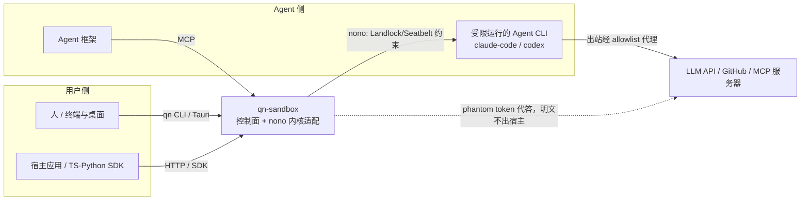
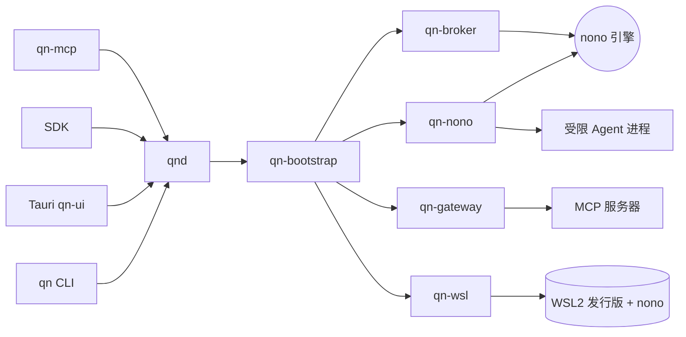

# 架构拆分（System Architecture Breakdown）

状态：Draft · 2026-10-24 · 配套规则见 [spec/01-architecture.md](./spec/01-architecture.md)

> 分工：01 管规则（为什么、允许什么、禁止什么），本文管结构（拆成哪些部分、边界在哪、如何对接）。冲突以 01 为准。

---

## 1. 系统上下文（C4 L1）

qn-sandbox 是**单机桌面软件**：在一台 macOS / Windows 机器上，让 AI 编码代理（Claude Code、Codex、dsh）
在内核强制的最小权限下运行，凭证永不进沙箱。



| 参与者 | 与系统的关系 | 关键诉求 |
| --- | --- | --- |
| 人（最终用户） | CLI / Tauri 壳 | 零技术配置、5 分钟可用、看得到审计 |
| 宿主应用 | SDK/HTTP | 接口稳定、类型安全 |
| Agent 框架 | MCP | 工具语义清晰、授权可撤销 |
| 受限 Agent CLI | 被内核原语约束运行 | 能干活（fs 白名单内、放行域名可达）但拿不到凭证 |
| 外部服务（LLM/MCP） | 出站目标 | 只经 allowlist 代理访问 |

---

## 2. 容器视图（C4 L2）——分发包与进程

| 容器 | 形态 | 职责 | 不做什么 | 对外通信 |
| --- | --- | --- | --- | --- |
| `qn`（CLI） | 独立二进制 | 人机入口：run/status/audit/doctor、profile 管理 | 业务规则 | 连 qnd；`--direct` 进程内直用 core |
| `qnd`（控制面后端 daemon） | 常驻进程 | 装配适配器、状态与审计查询、M3 起 HTTP API | 业务规则（在 core）、直连 nono 细节 | 127.0.0.1 + token；被 CLI/Tauri/SDK/MCP 使用 |
| `qn-ui`（Tauri 壳） | 桌面应用 | profiles / 权限 / 状态 / 审计四视图 | 任何后端逻辑 | 只走 qnd |
| **nono**（外部单二进制） | 第三方引擎 | 进程沙箱（Seatbelt/Landlock）、phantom token 凭证代理、L7 网络规则、防篡改审计 | ——（我们不改其源码，锁版本） | 被 qn-nono 以子进程/FFI 驱动；代理承接沙箱出站 |
| WSL2 发行版（仅 Windows） | 受管 Linux 环境 | 承载 nono 与 Agent CLI 运行 | —— | qn-wsl 经 `wsl.exe` 供给与管理 |
| OS 凭证库 | 外部存储 | 真实凭证宿主侧存放（跟随 nono 机制）；qn 自身 token | —— | keyring 仅 qn-daemon |
| 本地状态 | `~/.qn/` | 配置、会话注册、审计缓存、日志 | 凭证明文 | 文件锁串行 |



---

## 3. 组件视图（C4 L3）——逐 crate（五要素：职责/边界/内部模块/接口/测试）

### 3.1 `qn-core` — 领域内核
- **职责**：领域模型、状态机、ports；能力只写一遍的地方。
- **边界**：不依赖适配器/surface/平台 API；不做 IO。
- **内部模块**：`domain::session`（Session/RunSpec/SessionStatus/StopMode + 状态机唯一迁移表）、`domain::profile`（ProfileRef/权限集/凭证绑定）、`domain::secret`（SecretRef/Grant/GrantScope/AgentAppId）、`domain::audit`（AuditEvent/Denial）、`port::`（SandboxEngine/CredentialBroker/McpGateway）、`service::`（RunService：profile 解析→grant→run→登记；McpService）、`registry`（会话注册表 trait + 内存实现）、`error`。
- **测试**：状态机穷举、服务编排用 fake 引擎、serde round-trip。

### 3.2 `qn-nono` — 引擎适配器（A 负责人）
- **职责**：nono 安装与版本锁、`run --profile` 拉起、status/`why` 透传、审计日志采集；实现 `SandboxEngine`。
- **边界**：全仓唯一触碰 nono 的 crate；不自研任何隔离机制。
- **内部模块**：`installer`（下载/校验/锁版）、`runner`（子进程或 FFI——M0 spike 定）、`profile_gen`（core Profile → nono profile JSON）、`audit_tail`（审计流采集与 Denial 结构化）、`why`（拒绝原因透传）。
- **测试**：对 nono 的契约测试（真二进制，CI 缓存）；profile 生成快照测试。

### 3.3 `qn-broker` — 凭证代答（A 负责人）
- **职责**：包装 nono phantom-token 代理与上游 allowlist；grant/revoke 生命周期；实现 `CredentialBroker`；托管配置校验（明文即拒绝）。
- **内部模块**：`grant_table`（会话×引用×作用域，TTL/撤销）、`managed_config`（MCP/Agent 配置校验与写入——引用/句柄白名单）、`audit`（只记引用名不记值）。
- **测试**：grant 生命周期、托管配置明文拒绝矩阵、撤销即断供。

### 3.4 `qn-gateway` — MCP mediation（C 负责人）
- **职责**：宿主侧代答 MCP 服务器认证（agent 配置只有 Handle）；实现 `McpGateway`。
- **内部模块**：`registry`（McpServerRef→Handle）、`mediator`（请求转发+认证附加）、`config_emit`（向沙箱输出的配置只含 Handle/代理地址）。
- **测试**：注册/代答/撤销流；配置产出零明文断言。

### 3.5 `qn-wsl` — Windows 供给链路（B / gac0812 负责人）
- **职责**：WSL2 发行版安装、内核版本探测与升级（Landlock 网络 ≥6.7）、nono 引导、宿主↔WSL2 代理打通；一键化。
- **边界**：无 macOS 代码；输出解析只依赖退出码与结构化标记。
- **内部模块**：`distro`（发行版生命周期）、`kernel`（版本探测/升级路径，spike ① 产出物落地）、`bootstrap`（nono 安装与代理配置下发）、`health`（doctor 探测）。
- **测试**：stub `wsl.exe` 契约测试 + Windows 真机 E2E。

### 3.6 `qn-daemon` / `qn-cli` / `qn-ui` / `qn-mcp` — 控制面（C 负责人）
- `qn-daemon`：`api`（M3 起 ConnectRPC；此前进程内接口）、`store`（会话注册落盘，fail-closed）、`events`（生命周期/审计事件流）。薄壳，无业务规则。
- `qn-cli`：`commands`（run/status/audit/doctor/mcp/profile）、`output`（human/json）、`doctor`（nono 版本/Seatbelt-Landlock 可用性/WSL2 内核——用户友好的落地件）。
- `qn-ui`：Tauri 壳，四视图组件；全部数据走 qnd。
- `qn-mcp`：沙箱能力映射为 MCP tools（M3）。

### 3.7 `qn-config` / `qn-infra` / `qn-bootstrap` — 基座
- `qn-config`：config.toml + `QN_*` 合并、路径布局（§7）、nono 锁定版本常量；`#[cfg]` 白名单位置。
- `qn-infra`：`process`（外部命令统一封装：超时/截断/退出码）、`fs`、`lockfile`、`logging`、`retry`。
- `qn-bootstrap`：按平台装配唯一适配器组合（macOS：nono 直跑；Windows：qn-wsl 供给 + nono in WSL2）；`#[cfg]` 白名单位置。

### 3.8 `qn-vm`（P2 占位，不实现）与 `sdks/`
- `qn-vm`：强隔离模式（VZ/QEMU + guest 内 nono），P2 立项；实现同一 `SandboxEngine` port。
- SDK：契约生成 + 薄层（M3，规范 03）。

---

## 4. Crate 依赖矩阵（✓ 允许 / ✗ 禁止；cargo-deny ban 强制）

| from ↓ \ to → | core | config | infra | bootstrap | nono | broker | gateway | wsl | daemon |
| --- | --- | --- | --- | --- | --- | --- | --- | --- | --- |
| core | — | ✗ | ✗ | ✗ | ✗ | ✗ | ✗ | ✗ | ✗ |
| config / infra | ✗ | — | ✓ | ✗ | ✗ | ✗ | ✗ | ✗ | ✗ |
| qn-nono | ✓ | ✓ | ✓ | ✗ | —（自身） | ✗ | ✗ | ✗ | ✗ |
| qn-broker | ✓ | ✓ | ✓ | ✗ | ✓（经其代理 API） | — | ✗ | ✗ | ✗ |
| qn-gateway | ✓ | ✓ | ✓ | ✗ | ✗ | ✓（grant 校验） | — | ✗ | ✗ |
| qn-wsl | ✓ | ✓ | ✓ | ✗ | ✗ | ✗ | ✗ | — | ✗ |
| bootstrap | ✓ | ✓ | ✓ | — | ✓ | ✓ | ✓ | ✓ | ✗ |
| daemon / cli / ui / mcp | ✓ | ✓ | ✓ | ✓ | ✗（经 bootstrap） | ✗ | ✗ | ✗ | — |

要点：core 零依赖被所有人依赖；**qn-nono 是唯一触碰 nono 的 crate**；bootstrap 是唯一组合根。

## 5. 接口契约（port 语义表，签名见 01 §4）

### 5.1 `SandboxEngine`
| 方法 | 语义与不变式 | 幂等性 | 错误变体 |
| --- | --- | --- | --- |
| `run(spec)` | profile 先解析成功；限制施加不可逆；**默认拒绝、按 profile 放行**；失败不留半开进程 | 同 spec 重复 → 新 Session | `InvalidProfile`、`EngineUnavailable`、`ResourceExhausted` |
| `status(id)` | 只读；状态值出自 core 枚举 | 是 | `NotFound` |
| `explain(id)` | 返回 Denial 列表（透传 nono why） | 是 | `NotFound` |
| `stop(id, mode)` | Graceful：TERM→超时→KILL；Kill：立即 | 已停 → Ok | `StateConflict`、`Timeout` |

### 5.2 `CredentialBroker`
| 方法 | 语义 | 安全不变式（08 §4） |
| --- | --- | --- |
| `grant(id, refs, scope)` | 授予引用使用权；phantom token 就绪；审计记引用名+时间+会话 | 明文路径仅：宿主存储 → nono 代理 → 出站认证字段 |
| `write_managed_config` | 校验并写 agent/MCP 配置 | 出现明文即拒绝；只允许 Handle/引用/代理地址 |
| `revoke(grant)` | 立即断供 | 该会话后续出站即刻失去认证 |

### 5.3 `McpGateway`
| 方法 | 语义 |
| --- | --- |
| `register(server)` | 登记 MCP 服务器（真实凭证留宿主侧），产出 Handle |
| `mediate(handle, req)` | 转发请求并在宿主侧附加认证；Handle 失效即拒 |
| `revoke(handle)` | 立即失效 |

## 6. 通道与协议视图

| 通道 | 机制 | 备注 |
| --- | --- | --- |
| qnd ↔ nono | 子进程或 FFI（M0 spike 定）；审计经文件/流采集 | 唯一经 qn-nono |
| 沙箱出站 ↔ 外部 | nono 凭证代理（allowlist + phantom token 附加认证） | 越权即拒 + Denial |
| qnd ↔ WSL2 | `wsl.exe` 命令 + localhost 代理 | 仅 Windows |
| 控制面对外（M3） | ConnectRPC（契约同源生成 SDK/qn-mcp） | 单一契约源 |

## 7. 数据视图（`~/.qn/`；Windows 路径由 qn-config 解析）

```
~/.qn/
├── config.toml            # 用户配置（无任何凭证字段）
├── token                  # qnd 本地访问凭证（0600）
├── sessions.json          # 会话注册表（fd-lock；损坏 fail-closed → qn doctor --repair）
├── profiles/              # 官方/用户 profile 缓存（来源 registry 或本仓库）
├── audit/                 # 审计事件缓存（防篡改源在 nono 侧，此处为呈现副本）
├── logs/                  # qnd 滚动日志（tracing json；无凭证）
└── cache/                 # nono 安装包/临时文件（可随时清空）
```

规则：真实凭证不在 `~/.qn/` 任何位置（跟随 nono 宿主侧机制）；一切状态可删除重建。

## 8. 质量属性 → 架构决策映射

| 质量属性 | 支撑决策 |
| --- | --- |
| 安全 | 内核原语不可逆（nono）；默认拒绝+profile 放行；凭证代答+Handle；托管配置明文即拒；注册表 fail-closed；审计防篡改 |
| 可移植 | 引擎差异封在 qn-nono；Windows 差异封在 qn-wsl；`#[cfg]` 白名单三处 |
| 性能 | 进程级零 VM 开销；代理长连接；审计异步采集 |
| 可演进 | 引擎可替换（port）；P2 强隔离 VM 复用同一 port；契约先行（M3） |
| 可验证 | port 语义表直接生成测试清单；攻击演示剧本即安全回归（05 §2） |

## 9. 拆分演进规则

- 新增 port：≥2 实现或 ≥2 使用方才进 core；否则留 crate 私有。
- 新增 crate：仅当依赖矩阵出现新行或出现重复装配/重复类型时。
- 适配器内部再抽象（如 qn-wsl 的内核升级策略）：负责人自决，不上升 core。
- 废弃 port/签名：三人一致 + 决策 issue（09 §4），旧实现保留一个里程碑周期。
